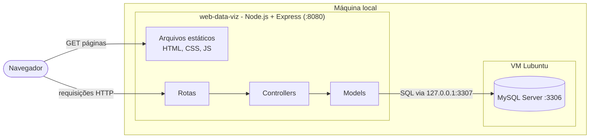

<h1 align="left">
  
  Pumpkin - Comunidade voltada para designers ou entusiastas
</h1>

## Sumário

- [Stack](#stack)
- [Arquitetura](#arquitetura)
- [Pré-requisitos](#pré-requisitos)
- [Instalação e execução](#instalação-e-execução)
- [Banco de dados](#banco-de-dados)
- [Solução de problemas](#solução-de-problemas)
- [Autor](#autor)

## Stack

| Camada | Tecnologia | Responsabilidade |
| --- | --- | --- |
| Front-end | HTML, CSS, JavaScript | Páginas, formulários, quiz e dashboard |
| Back-end | Node.js, Express | Servidor HTTP, rotas e regras da aplicação |
| Banco de dados | MySQL | Persistência dos dados |
| Infraestrutura | VM Lubuntu | Hospedagem do MySQL Server |

## Arquitetura



### Fluxo de uma requisição

1. O navegador carrega as páginas servidas pela aplicação em `localhost:8080`.
2. O JavaScript do front-end envia uma requisição HTTP para uma rota do Express.
3. A rota encaminha a chamada ao controller, que valida os dados recebidos.
4. O model monta e executa a consulta SQL.
5. A conexão sai pela porta `3307` da máquina local e é redirecionada para a porta `3306` da VM.
6. O resultado retorna ao front-end como resposta HTTP.

### Portas

| Serviço | Onde roda | Porta |
| --- | --- | --- |
| Aplicação Node.js | Máquina local | `8080` |
| Redirecionamento do virtualizador | Máquina local | `3307` |
| MySQL Server | VM Lubuntu | `3306` |

## Pré-requisitos

- Git
- Node.js e npm
- VM Lubuntu configurada com o banco de dados do projeto

## Instalação e execução

### 1. Clonar o repositório

```bash
git clone <url-do-repositorio>
cd <pasta-do-projeto>
```

### 2. Ligar a máquina virtual

Ligue a VM Lubuntu e mantenha-a em execução enquanto usa a aplicação.

### 3. Configurar as variáveis de ambiente (máquina local)

No arquivo `.env.dev`, na raiz do projeto:

```env
AMBIENTE_PROCESSO=desenvolvimento

DB_HOST=127.0.0.1
DB_PORT=3307
DB_DATABASE=pumpkin
DB_USER=<seu-usuario>
DB_PASSWORD=<sua-senha>

APP_HOST=localhost
APP_PORT=8080
```

> Não envie senhas reais para o repositório.

### 4. Instalar as dependências e iniciar

```bash
npm install
npm start
```

Acesse [http://localhost:8080](http://localhost:8080). Para encerrar o servidor, use `Ctrl + C`.

## Banco de dados

O script `scriptBD.sql` cria a estrutura do banco. Entre as tabelas do projeto estão:

| Tabela | Conteúdo |
| --- | --- |
| `news` | Notícias: `id`, `title`, `sumary`, `content`, `image`, `date_publication`, `link` |
| `quiz` | Dados do quiz |
| `creative_profile` | Perfis criativos: Ousado, Clássico, Minimalista e Expressivo |
| `question` | Perguntas do quiz |
| `answer_option` | Alternativas, que somam pontos para um perfil |

## Solução de problemas

| Sintoma | O que verificar |
| --- | --- |
| `ECONNREFUSED 127.0.0.1:3307` | VM ligada |
| Conexão perdida ou encerrada ao conectar | VM ligada e inicializada por completo |
| `ER_ACCESS_DENIED_ERROR` | Usuário e senha no `.env.dev` |
| `ER_BAD_DB_ERROR` | Valor de `DB_DATABASE` |
| `EADDRINUSE` na porta `8080` | Outro processo usando a porta |

## Autor

**Gabriel Cavalcante Santos**<br>
Ciência da Computação, São Paulo Tech School